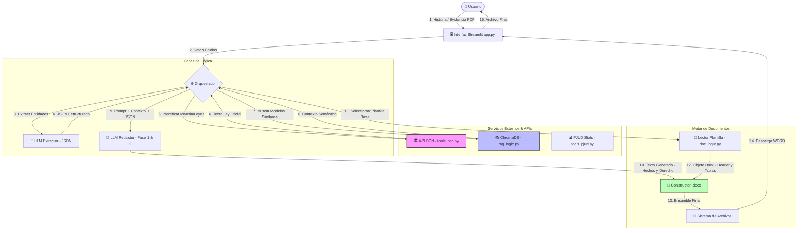

# Arquitectura del Sistema: Agente Judicial

Este documento describe el flujo de datos y la arquitectura técnica del Agente Judicial, con énfasis en la integridad de datos y la orquestación de servicios externos (BCN, RAG y Motor de Documentos).

## Diagrama de Flujo de Datos

El siguiente diagrama Mermaid ilustra cómo una solicitud de usuario se transforma en un documento legal válido.

## Explicación de Componentes

### 1. Orquestador (`app.py`)
Es el cerebro de la aplicación. Maneja el estado de la sesión (`st.session_state`), decide qué herramientas llamar y coordina el flujo en dos fases críticas:
*   **Fase de Análisis:** Llama al Extractor para convertir texto libre en datos estructurados.
*   **Fase de Generación:** Construye el prompt final inyectando el contexto legal (BCN) y los ejemplos (RAG).

### 2. Conector BCN (`tools_bcn.py`)
Garantiza la validez jurídica.
*   **Input:** Identificador de Ley (ej: "14908").
*   **Proceso:** Consulta la API XML de leychile.cl.
*   **Output:** Texto limpio y vigente de la norma para que el LLM no "alucine" leyes derogadas.

### 3. Motor de Documentos (`doc_logic.py`)
Responsable de la fidelidad visual.
*   **Preservación:** No genera texto plano; manipula objetos `python-docx`.
*   **Hibridación:** Mantiene el encabezado y las tablas originales de la plantilla del usuario y solo inyecta el contenido nuevo generado por la IA en el cuerpo del documento.
